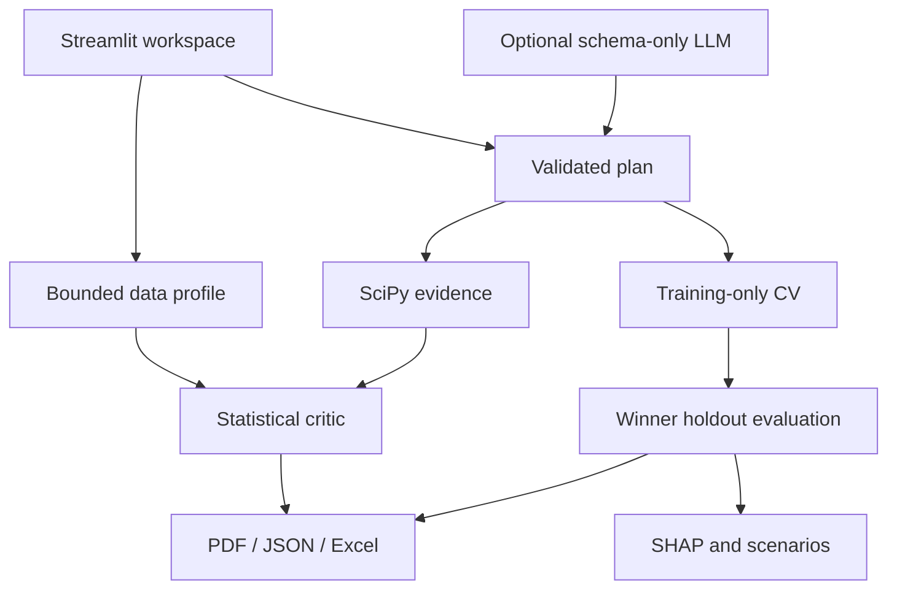

> Historical MVP record. The current product release is documented in [PRODUCT_GUIDE.md](PRODUCT_GUIDE.md), [PRODUCT_ARCHITECTURE.md](PRODUCT_ARCHITECTURE.md), and [release/VALIDATION.md](release/VALIDATION.md).

# Architecture and source reuse audit

Audited on November 15, 2026 against main commit
`a5b8b0b3f44e6368c9a28f4133473a0f49d33888` in
`Sidsidhuz/Enterprise-Data-Intelligence-Platform`.
The saved November 13 plan was readable; its ZIP could not be materialized
in this environment, so no claim is made to reuse that archive's code.
This implementation is a new v2 package alongside the verified original.

## Reusable foundation

| Original file | Verified behavior | V2 decision |
|---|---|---|
| `app/modules/upload/upload_service.py` | Chunked upload limit; Dataset record and local file storage | Retain for future API integration; v2 uses bounded in-memory parsing |
| `app/modules/profiling/profiling_service.py` | Missingness, dtypes, duplicate and IQR outlier counts | Adapt profile concepts into pure functions with target-risk checks |
| `app/modules/cleaning/cleaning_service.py` | Fits median/mode on the entire cleaned dataset before AutoML splits | Do not use this output for v2 ML; use raw rows and fit preprocessing inside CV |
| `app/modules/feature_engineering/feature_service.py` | ColumnTransformer, imputers, scaling, one-hot/ordinal encoding | **Directly imported and reused** by `v2/modeling.py` |
| `app/modules/automl/automl_service.py` | Three-trial RandomizedSearchCV per candidate; winner chosen by holdout metric | Reimplement a bounded 3-model comparison with explicit CV scoring; holdout only for the winner |
| Same AutoML service | Uses F1 as a substitute for unavailable ROC-AUC | V2 does not substitute a different metric under the AUC name |
| `app/modules/explainability/shap_service.py` | Tree/linear/kernel explanation and image exports | Reuse explainer approach; new real scenario SHAP with output units and additivity check |
| `app/modules/reports/report_service.py` | ReportLab and OpenPyXL reports driven by DB records | Adapt report construction into in-memory exports with computed challenge evidence |
| `frontend/streamlit_app.py` | Existing no-code UI calls separate FastAPI backend | Retain entrypoint; new `v2/app.py` is a standalone UI over shared Python services |
| `app/database.py`, `app/models/*` | SQLite/SQLAlchemy models | Retain for later persistent investigation history; v2 sessions are in memory |

The v2 branch also switches the shared Streamlit theme to light teal. No
original business service is edited. The app does not claim every existing
stack dependency is needed in its first deployment. XGBoost and broader
tuning are deferred to keep the live demonstration quick and reproducible.

## Execution flow

## Modules and contracts

| Module | Responsibility | Input → output |
|---|---|---|
| `data.py` | Parse, bound, validate; synthetic demo; hash | Bytes → DataFrame; DataFrame → SHA-256 |
| `quality.py` | Missingness, duplicates, explicit risk heuristics | DataFrame + target → profile/risk records |
| `planner.py` | Offline or LLM mapping; validate columns and derive test | Question + schema → plan dictionary |
| `statistics.py` | Welch, Spearman, categorical tests; effect/interval/exclusions | Confirmed plan + data → finding |
| `challenge.py` | Check evidence, permutation sensitivity, stratified tests, Holm correction | Finding + data + profile → reviewer record |
| `modeling.py` | Reused FeatureService; train-only CV, final holdout, SHAP | Raw data + explicit task → bundle; bundle + scenario → explanation |
| `reporting.py` | Only computed evidence; escaped PDF text and Excel formula protection | Evidence package → PDF/JSON/XLSX bytes |
| `app.py` | UI, session isolation, explicit user confirmation | User actions → engine calls |

## The trust boundary

The LLM proposes column mappings and a reason. Python determines which
whitelisted test is valid, checks input values, and computes all numbers.
No model-generated code is executed. No raw dataset rows go to the LLM.
Unknown columns or API failures produce an explicit error.

The critic reads the actual test result and recomputes sensitivity/stratum
evidence. It does not ask an LLM to invent objections. Reversal means every
tested stratum with at least two valid strata has the opposite effect sign.
Sparse or invalid strata are disclosed; the warning is not a causal estimate.

## Statistical and ML boundaries

- The chosen bivariate question is exploratory. A p-value below 0.05 is not
  proof of importance, and not a causal finding.
- Confidence intervals express sampling uncertainty under assumptions; they
  do not absorb selection bias, missing-data bias, or model misspecification.
- The critic's studentized permutation test uses 499 resamples and seed 42.
  Exchangeability matters; a permutation check is not universally superior
  to Welch's unequal-variance test.
- Holm adjustment covers the displayed stratum-test family only, not all
  questions a user might try. Repeating questions needs independent validation.
- Target-missing rows are excluded from training. Modeling duplicates are
  removed before splitting. Training requires 40 distinct labeled rows.
- Split 80/20, then profile training data for suspect features. Fit imputers,
  encoders, and scaling inside every CV fold. Three-fold CV selects a winner;
  fit that winner to training rows and evaluate it once on the holdout.
- The app can be rerun, but repeatedly tuning against the displayed holdout
  invalidates its role as a final independent estimate.
- SHAP uses TreeExplainer or LinearExplainer. Forest classification values
  are in probability units; binary logistic values are in log-odds units.
  A displayed additivity error checks base plus attributions against output.

## Next architecture step after the demo

Compose these pure functions under an `investigations` FastAPI router, rather
than moving computation into routes. Persist Dataset → Investigation →
Finding → Challenge records using the existing SQLAlchemy layer. Save the
dataset hash, confirmed plan, code revision, dependency versions, parameters,
seed, and result JSON. Add authenticated ownership, a retention policy, and
bounded background jobs before accepting real multiuser business uploads.

The deployment in this milestone is Streamlit plus Python services. The
existing FastAPI/SQLite architecture is a natural integration path, not a
dependency the demonstration must start and configure separately.
