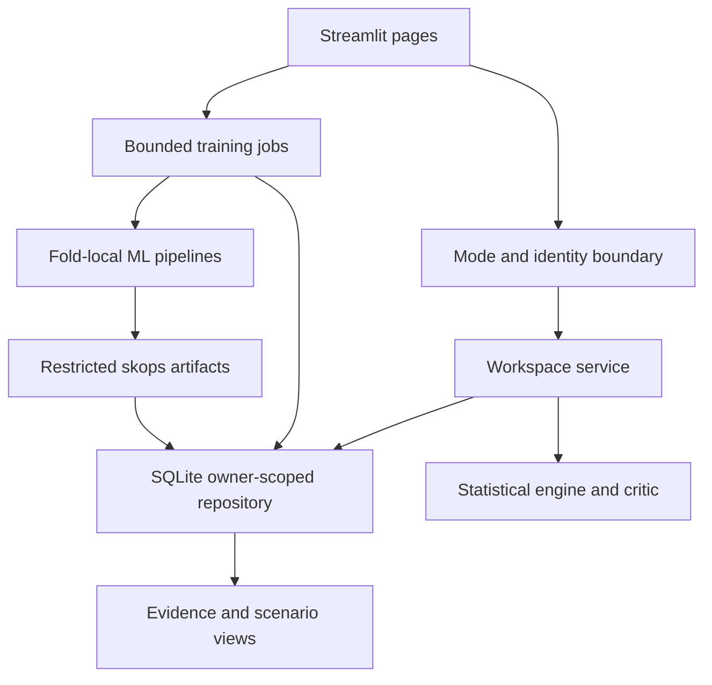

# Product architecture

The UI is a presentation layer. It does not own persistence or decide which
statistical/ML operations are valid. The same application service boundary
can later be called by an Ollama controller or FastAPI adapter.

## Components

| Component | Responsibility |
|---|---|
| config.py | Explicit mode and resource settings; demo is the default |
| auth.py | Admin provisioning, password hashing, verification, throttling |
| storage.py | Schema v1, transactions, ownership checks, quotas, backup |
| service.py | Import, start investigation, review, validate export provenance |
| jobs.py | Worker lifecycle, idempotency, cancellation, progress, error boundaries |
| training.py | Explicit validation splits, preprocessing/CV, final evaluation |
| artifacts.py | Restricted serialization, integrity and version checks |
| modeling.py | Input validation, prediction, real SHAP and additivity checks |
| statistics.py / challenge.py | Actual statistical evidence and independent review |
| reporting.py | Computed reports; escaped PDF text and Excel formula protection |
| ui/ | Navigation, forms, empty/error/loading states, graphs and downloads |
| launch.py / manage.py | Safe binding defaults; accounts, backup and retention |

## Lifecycle invariants

1. Every dataset, run and model lookup includes its owner. Knowing another
   record's identifier is insufficient to retrieve, mutate, cancel or export it.
2. Dataset content is immutable under an identifier. A new content hash creates
   a new dataset; importing identical content is idempotent within an owner.
3. A saved finding retains the confirmed plan and dataset/engine fingerprint.
   A challenge verifies the current dataset fingerprint before updating it.
4. Reports require a completed challenge. An attached model must match the
   investigation's dataset hash; its target/task/split are disclosed separately.
5. Training never calls UI APIs. The UI polls a persisted job record; changing
   pages or losing the websocket does not cancel an active worker.
6. Identical completed configurations reuse their original model. Workers
   publish complete metadata/artifact/reference rows in one transaction.
7. Cancellation and publication race through a conditional SQL update. A
   cancellation that wins before publication cannot leave a partial model.
8. Jobs abandoned beyond the timeout plus grace window become interrupted.
   They are not mislabeled successful. Recovery happens at runner startup.
9. No uploaded model files or arbitrary generated code are executed. skops
   types are checked against default support plus a fixed reviewed descriptor.
10. UI state is cleared on owner or dataset change. New operations clear old
    transient results before running, so failures do not masquerade as success.

## Reuse

The original FeatureService remains directly imported for ColumnTransformer
construction. Its transforms now fit inside each validation fold. The original
FastAPI/SQLite service tree remains untouched; this release owns a separate
workspace database to avoid coupling new jobs to the old cleaning workflow.
The existing statistical critic, SHAP approach, ReportLab/OpenPyXL rendering,
and synthetic demonstration are preserved and hardened.

ARCHITECTURE.md contains the historical source audit of the original project.
This document describes the current operational architecture.

## Scaling boundary

The supported topology is one application process with two bounded workers
and a local persistent volume. SQLite WAL and transactions protect concurrent
threads; they are not a substitute for a distributed queue. Before adding
multiple replicas, move ownership/persistence to a shared database, use a
dedicated job system, place data/artifacts in object storage, and add shared
rate limits and managed identity. Do not just increase replica count.
